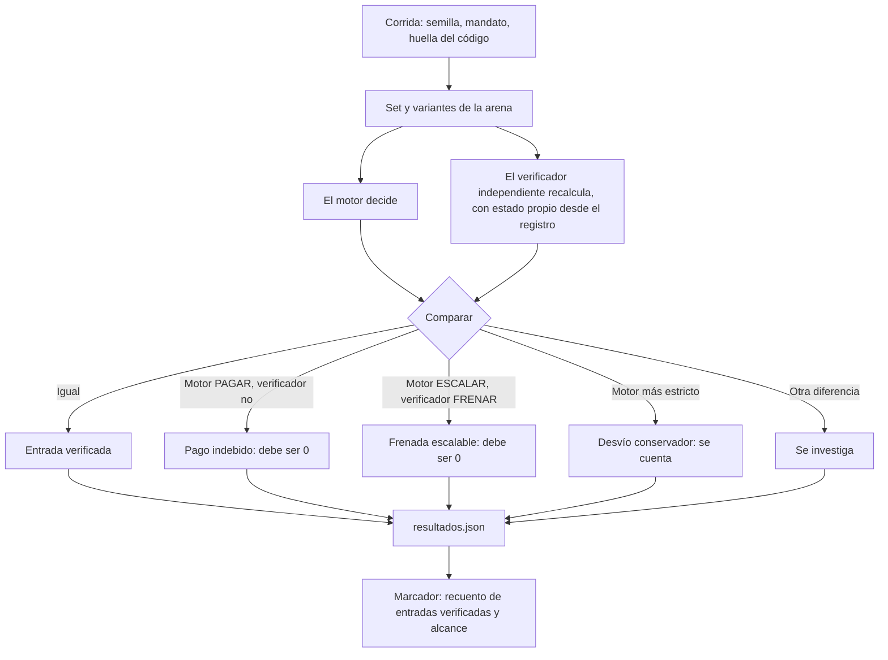

# Modelo de lógica de la evaluación: U4

## Corrida de evaluación

## Facturas ocultas
`Sellar huellas y política → correr una vez al final → reportar tal cual → diagnosticar cada fallo → si hay corrección, segunda corrida con fecha y versión y aviso de que ya no es ciega`.

## Pentest
`Mandato v1 → seis estrategias con esperado escrito antes → comparar con el verificador → hueco: corregir o documentar → mandato v2 → repetir con la misma semilla → mostrar antes y después`.

## Mutación
`Copia temporal → aplicar un mutante → correr las pruebas → registrar cuál falla → si ninguna falla, hallazgo → restaurar la copia`.

## Qué nunca ocurre
- Un esperado calculado con el motor.
- Un mutante que sobrevive sin quedar anotado.
- Un cambio al motor para pasar las ocultas que no se reporte.
- Una cifra de "0" sin su alcance.
