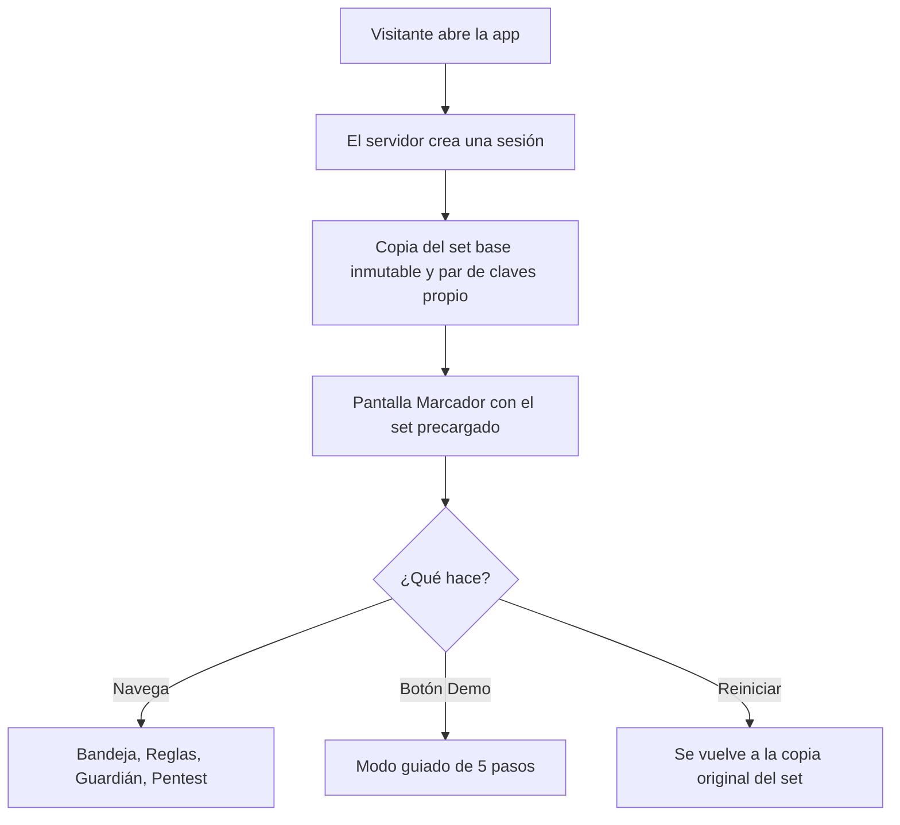
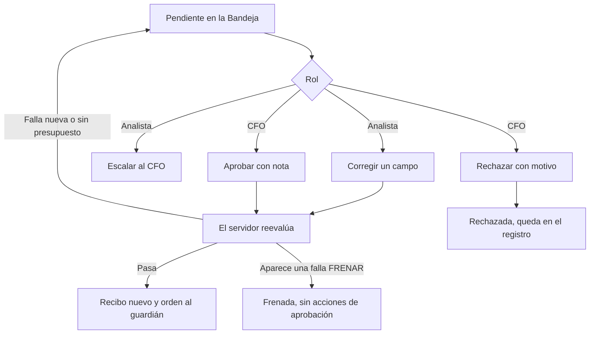

# Modelo de lógica de la interfaz: U3

## 1. Apertura de una sesión

## 2. Escalada: de la bandeja a la decisión

## 3. Verificar un recibo
`Ver el recibo → conmutar a la vista técnica → pulsar Verificar → se recalcula la firma sobre el mismo JSON mostrado con la clave pública de la sesión → ✓ o ✗`. Si el JSON se altera, la verificación falla.

## 4. Mandato nuevo desde el pentest
`El pentest sobre v1 encuentra un hueco → arreglo propuesto → el CFO propone v2 → el analista contrafirma → v2 vigente → se repite el pentest`. Cada paso queda con el rol.

## 5. Cierre del ciclo
`Todas las escaladas con una acción humana → el CFO pulsa Cerrar ciclo → instantánea inmutable → se descarga la conciliación`. Si queda una escalada sin atender, el botón está deshabilitado y dice cuántas faltan.

## 6. Modo guiado
Los pasos están en `business-rules.md`. La guía solo mueve la pantalla, el rol y el estado; no tiene lógica propia: usa las mismas acciones que un usuario.
