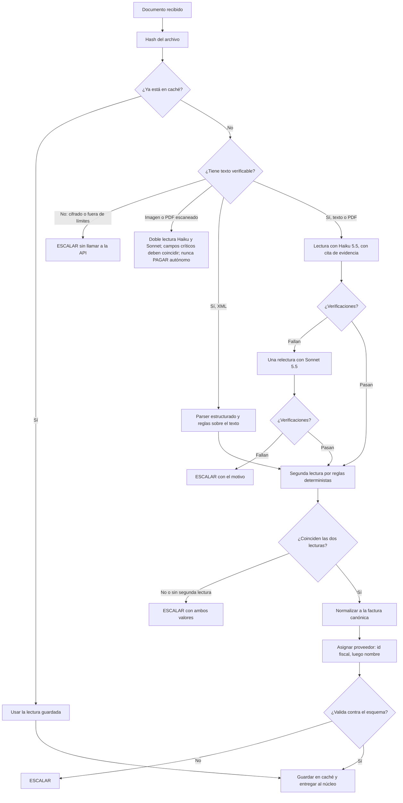

# Modelo de lógica de la lectura: U2

## Flujo de lectura de un documento

## Fallas de la API en cualquier punto
Una falla de la API se resuelve según la tabla de `business-rules.md`. En todos los casos el resultado es una factura canónica **incompleta con el motivo**, que el núcleo convierte en ESCALAR.

## Qué entrega U2 al núcleo
La factura canónica, la confianza por campo, el resultado de cada verificación (esquema, dinero, suma, cita, tipo, segunda lectura), el modelo y los tokens usados, los reintentos, el costo y, si hubo, el motivo de la falla.

## Qué nunca ocurre
- Una lectura que decide un pago.
- Un campo de dinero sin segunda lectura que llegue como confiable.
- Una subida de modelo evitada por una confianza alta del propio modelo.
- Un documento sin texto verificable enviado a la API.
