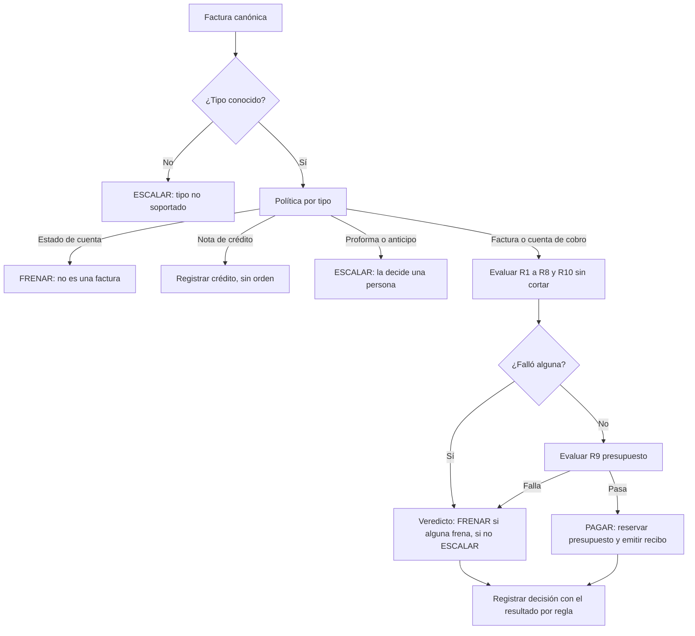
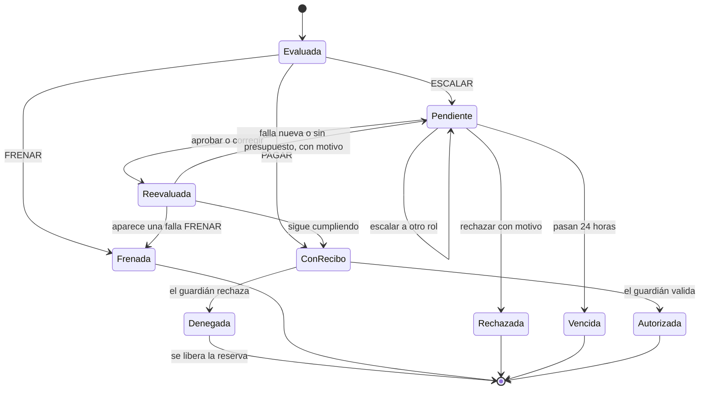

# Modelo de lógica de negocio: U1 Núcleo

## 1. Evaluación de una factura

## 2. Ciclo de vida de una decisión

## 3. Mandato
`Propuesto por el CFO → Contrafirmado por el analista → Vigente (versión n)`. Una versión nueva no cambia las decisiones ya tomadas: cada recibo lleva la versión con la que se emitió. El guardián rechaza recibos de una versión que ya no es la vigente.

## 4. Reserva de presupuesto
Se hace en la misma transacción que registra la decisión y consume el identificador del recibo. El presupuesto restante es la suma de las reservas del periodo, no un número editable. Una denegación del guardián, un vencimiento o un rechazo generan un movimiento compensatorio.

## 5. Recibo y guardián
El recibo contiene: factura, hash del documento, beneficiario, monto, veredicto, modo de autonomía (autónomo o sombra), resultado por regla, fallas aprobadas si las hay, versión del mandato, identificador aleatorio, vigencia y versión de la clave. El firmador (proceso aparte) lo firma. El guardián ejecuta las seis verificaciones y reevalúa el presupuesto antes de autorizar (ver `components.md`, C10 y C11). La verificación 4 queda así: PAGAR en modo autónomo; o ESCALAR con una aprobación firmada y vigente; o PAGAR en modo sombra con una aprobación firmada; nunca FRENAR. Esta verificación hay que reflejarla en el contrato.

## 6. Ciclo de pagos
`Abierto → En proceso → En revisión → Aprobado → Cerrado`. Se cierra cuando todas las escaladas tienen una acción humana; el cierre guarda una instantánea inmutable y exporta la conciliación.

## 7. Qué nunca ocurre
- Un PAGAR sin que todas las reglas apliquen y pasen, y con reserva hecha.
- Una orden autorizada para una factura frenada.
- Una aprobación sin reevaluación, o vencida.
- Un cambio del mandato con una sola firma.
