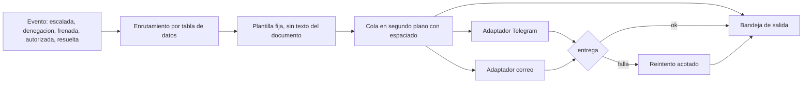

# Notificaciones por Telegram y correo

Fecha: 2026-10-17. Estado: **APROBADO PARA CONSTRUIR (Ola 19)**. Objetivo: que el sistema se vea vivo y que una persona se entere de lo importante sin abrir la aplicación. Contexto: `inception/architecture-target-vs-mvp.md` (3f y 3g) y `inception/personas.md`.

## Principios
1. **Informan, no actúan.** Sin botones de aprobar ni enlaces con credenciales. Aprobar solo ocurre en la aplicación, con el rol.
2. **Nunca bloquean ni cambian una decisión.** Un fallo de entrega se anota y se reintenta; la decisión ya está tomada y registrada.
3. **Texto seguro por construcción.** El mensaje se arma con plantillas fijas y datos del registro (nombre de proveedor del registro maestro, importe y moneda, regla en lenguaje llano). **Nunca** incluye texto libre del documento (ni la cita de una instrucción), ni números de cuenta. Se eliminan saltos y caracteres de control y se corta a 500 caracteres. Telegram se envía en texto plano, sin `parse_mode`.
4. **Secretos solo en el entorno.** Nunca en el repositorio ni en los registros ni en las respuestas de la API (el destino se muestra enmascarado).
5. **Sin configurar = simulado y visible.** El aviso queda en la bandeja de salida con el estado "simulada, sin configurar". Con las variables definidas, el mismo código envía de verdad.

## Eventos y destinatarios
| Evento | Quién se entera | Canales por defecto |
|---|---|---|
| Escalada pendiente de aprobación | CFO (y el analista) | Telegram y correo |
| Denegación del guardián (recibo alterado, vencido o reutilizado) | CFO y auditor | Telegram y correo (alerta de seguridad) |
| Factura frenada por las reglas | Analista | Correo |
| Decisión de pagar autorizada por el guardián | Analista | Telegram |
| Escalada resuelta (aprobada o rechazada) | Quien la escaló | Telegram |
| Prueba manual ("el sistema está vivo") | Quien la pide | Todos los canales configurados |
La tabla de enrutamiento (evento a canales) es un **dato** del mandato de notificaciones, no código.

## Configuración (variables de entorno)
| Variable | Uso |
|---|---|
| `TELEGRAM_BOT_TOKEN` | Token del bot, entregado por @BotFather |
| `TELEGRAM_CHAT_ID` | Chat de destino |
| `SMTP_HOST`, `SMTP_PORT`, `SMTP_USER`, `SMTP_PASSWORD`, `SMTP_FROM` | Servidor de correo (STARTTLS) |
| `NOTIFY_EMAIL_TO` | Destinatario del correo |
| `APP_BASE_URL` | Enlace a la aplicación dentro del mensaje (solo la ruta de la decisión) |
Cómo crear el bot (a cargo de quien administra el despliegue): hablar con @BotFather, crear el bot y copiar el token; abrir una conversación con el bot y obtener el `chat_id` (NO VERIFICADO en las páginas oficiales leídas; consultar la documentación de la Bot API).

## Entrega
- Puerto `Notificador` de un método (`enviar(mensaje)`), con adaptadores de Telegram, correo y bandeja de salida; el dominio no importa HTTP ni SMTP.
- Envío en **segundo plano** (no retrasa la respuesta de la API). Separación mínima de 1,1 s entre mensajes al mismo chat de Telegram (límite oficial: 1 por segundo por chat, 20 por minuto en grupos) y, si se acumulan más de 5 en 10 s, un único mensaje de resumen.
- Reintento acotado con espera creciente; ante un 429 se respeta la espera indicada; tras agotar los reintentos, estado "fallida" con el motivo.
- Cada intento queda en la **bandeja de salida** de la sesión: hora, evento, canal, destino enmascarado, estado (enviada, simulada, fallida) y el texto enviado.

## Rutas (contrato 1.1.0-rc6, aditivo)
- `GET /api/notificaciones`: bandeja de salida de la sesión.
- `POST /api/notificaciones/prueba`: envía un mensaje de prueba por los canales configurados (analista o CFO; limitado a una por 10 s).
- `GET /api/salud`: `{estado, version, mandato, lectura, libro, notificaciones: {telegram, correo}}` donde cada canal es "configurado" o "simulado".

## Diagrama

## Pruebas (sin red)
Transporte falso: plantilla sin texto del documento ni cuentas; modo simulado sin variables; un canal que falla no cambia la decisión; enmascarado del destino; espaciado y resumen.
