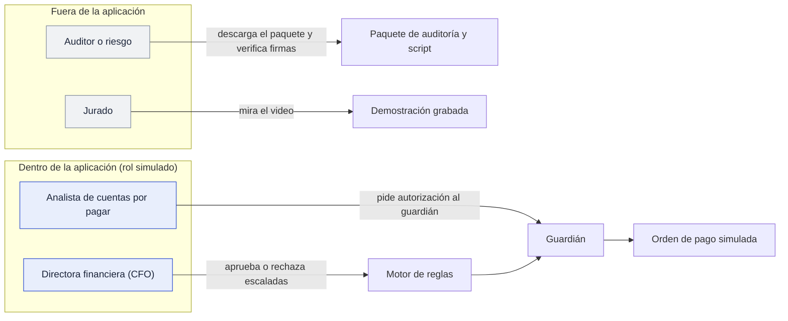
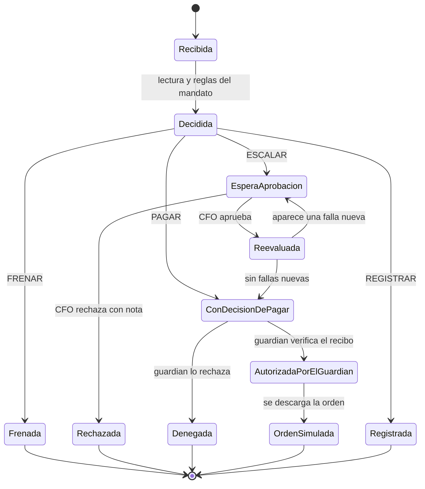
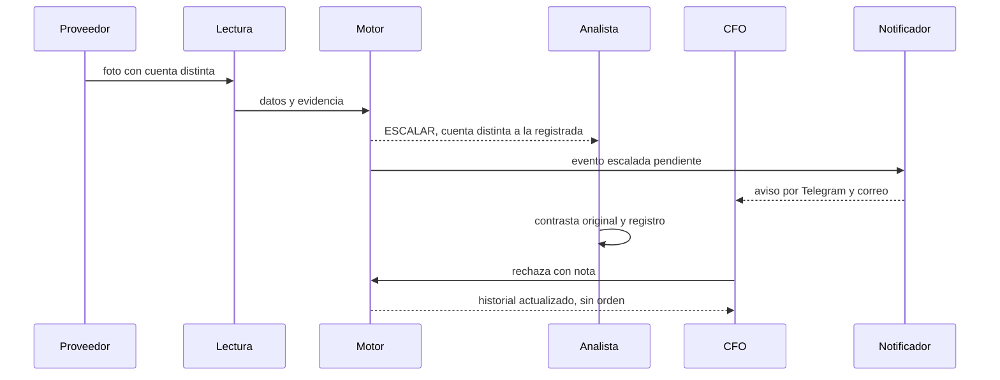
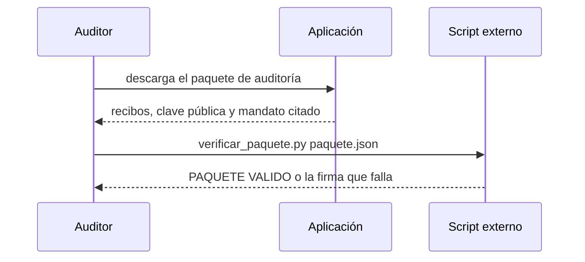

# Personas: qué hacen, qué pueden y qué no

Fecha: 2026-10-17. Las personas son **inferidas** del reto y de los roles del producto; NO se validaron con entrevistas. Los permisos de Analista y CFO vienen de `construction/interfaz/functional-design/business-rules.md` (aprobado). "Hoy" significa implementado y probado; "Diseño" significa aprobado pero aún sin construir.

## Mapa de personas y roles
En la aplicación existen **dos roles simulados**: Analista y CFO (selector con la etiqueta "rol simulado"). El auditor y el jurado **no son roles de la aplicación**: el auditor trabaja con el paquete de auditoría fuera de la app y el jurado solo ve el video.

## 1. Analista de cuentas por pagar
**Quién es:** recibe facturas por correo, chat, PDF y foto; hoy las revisa a mano. **Teme:** que el agente frene de más y le llene la bandeja, o que pague algo que luego le reclamen. **Quiere:** que cada escalada traiga el motivo escrito y qué hacer.

| Puede | Estado |
|---|---|
| Ver todas las decisiones, documentos, recibos e historial | Hoy |
| Buscar y filtrar documentos; abrir el original junto a lo leído y a las diferencias contra el registro | Hoy |
| Cargar las muestras del set (simula la recepción) | Hoy |
| Pedir la autorización del guardián para una decisión de pagar y descargar la orden simulada | Hoy |
| Verificar la firma de un recibo | Hoy |
| Corregir un campo mal leído y reevaluar | Diseño |
| Escalar una factura al CFO | Diseño |
| Contrafirmar un mandato propuesto por el CFO | Diseño |
| Recibir notificaciones de facturas frenadas y escaladas | Diseño (esta ola) |

| No puede |
|---|
| Aprobar o rechazar una escalada (los botones ni aparecen) |
| Proponer un mandato, promover un proveedor o cerrar el ciclo |
| Aprobar una factura frenada |
| Emitir una orden sin que el guardián autorice |

## 2. Directora financiera (CFO)
**Quién es:** responsable del dinero; firma los mandatos y resuelve las excepciones. **Teme:** ser la titular de un pago fuera de política o que el agente actúe sin que nadie lo vea. **Quiere:** menos revisión manual y poder explicarle a su junta cada decisión.

| Puede | Estado |
|---|---|
| Todo lo que ve el analista | Hoy |
| Aprobar una escalada aprobable (el motor reevalúa todas las reglas antes y emite un recibo nuevo) | Hoy |
| Rechazar una escalada con una nota obligatoria; queda en el historial | Hoy |
| Ver una vista previa de qué cambia si propone un mandato nuevo | Hoy |
| Pedir la autorización del guardián y descargar la orden simulada | Hoy |
| Proponer un mandato nuevo (con contrafirma del analista) | Diseño |
| Promover un proveedor de modo sombra a autónomo | Diseño |
| Cerrar el ciclo y exportar la conciliación | Diseño |
| Recibir notificaciones de escaladas pendientes y de denegaciones del guardián | Diseño (esta ola) |

| No puede |
|---|
| Aprobar una factura **frenada** (nadie puede) |
| Aprobar una escalada por **lectura dudosa** (R1) ni por **presupuesto insuficiente** (R9): solo rechazar o cambiar el mandato |
| Cambiar reglas sin la contrafirma del analista |
| Mover dinero: el producto solo propone una orden simulada |

## 3. Auditor o responsable de riesgo
**Quién es:** debe demostrar, meses después, quién decidió qué y con qué regla. **Teme:** un sistema que se audita a sí mismo. **Quiere:** verificar sin depender de nosotros.
**No es un rol de la aplicación hoy**; usa lo que la aplicación exporta.

| Puede | Estado |
|---|---|
| Descargar el paquete de auditoría (recibos, clave pública, mandato citado) | Hoy |
| Ejecutar el script `verificar_paquete.py` fuera de la aplicación y obtener "PAQUETE VALIDO" o el fallo | Hoy |
| Leer en la aplicación el recibo, la versión del mandato y el historial de una decisión (con acceso de Analista o CFO sin acciones) | Hoy |
| Consultar el pentest, la arena y la mutación como evidencia | Hoy |
| Un rol propio de **solo lectura** con acceso a todo el historial y sin acciones | Diseño |
| Recibir un resumen periódico de denegaciones y escaladas | Diseño |

| No puede |
|---|
| Aprobar, rechazar ni autorizar nada |
| Modificar el historial: el registro es de solo adición |

## 4. Jurado de la hackathon
No usa la aplicación: ve el pitch y un video de 3 minutos. **Busca:** una historia clara en 30 segundos y la prueba de que el agente no se deja engañar. Los recorridos del video son los mismos que usan las personas anteriores. **Puede:** juzgar con lo grabado y con los documentos públicos del repositorio. **No puede:** operar la aplicación; por eso el video muestra la alteración del recibo, la trampa y el ataque.

## 5. Actores del sistema (no son personas)
| Actor | Hace | No hace |
|---|---|---|
| Motor de reglas | Decide PAGAR, FRENAR, ESCALAR o REGISTRAR con el mandato | Mover dinero; obedecer texto del documento |
| Guardián | Verifica el recibo en el punto de pago y autoriza o deniega | Autorizar sin recibo válido, vigente y no usado |
| Modelo de lectura | Convierte un documento en datos con evidencia | Decidir un pago |
| Notificador | Avisa por Telegram, correo y bandeja de salida | Ejecutar acciones ni cambiar decisiones |

## Matriz de permisos
| Acción | Analista | CFO | Auditor | Jurado | Estado |
|---|:-:|:-:|:-:|:-:|---|
| Ver decisiones, documentos e historial | Sí | Sí | Sí (paquete) | Video | Hoy |
| Pedir autorización al guardián | Sí | Sí | No | No | Hoy |
| Aprobar una escalada aprobable | No | Sí | No | No | Hoy |
| Rechazar con nota | No | Sí | No | No | Hoy |
| Proponer y contrafirmar un mandato | Contrafirma | Propone | No | No | Diseño |
| Corregir un campo y reevaluar | Sí | No | No | No | Diseño |
| Verificar firmas fuera de la app | No aplica | No aplica | Sí | No | Hoy |
| Aprobar una factura frenada | Nadie | Nadie | Nadie | Nadie | Regla |
| Mover dinero real | Nadie | Nadie | Nadie | Nadie | Fuera de alcance |

## Ciclo de vida de una decisión

## Recorrido 1: del documento a la resolución (analista y CFO)

## Recorrido 2: reconstruir y verificar (auditor)

## Brechas conocidas
- El rol de auditor de solo lectura no existe: hoy se usa el paquete y el script.
- Corregir un campo, escalar, contrafirmar un mandato, promover un proveedor y cerrar el ciclo están aprobados en el diseño y no construidos.
- Las notificaciones se diseñan en `construction/nucleo/functional-design/notificaciones.md`.
- Las personas no se han validado con usuarios reales.
