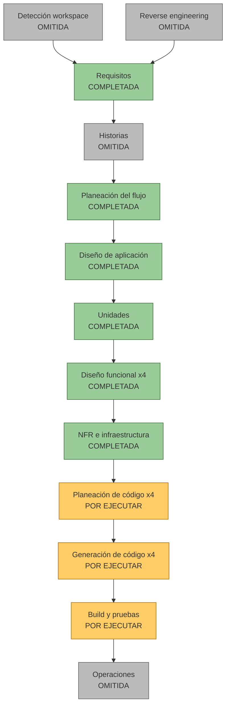

# Plan de ejecución

Etapa Workflow Planning de AI-DLC. Fecha: 2026-10-16. Estado de la ejecución (2026-10-17): olas 1 a 10 cerradas (ver `construction/tandas.md` y `aidlc-state.md`); quedan la puerta de calidad, el despliegue, el video y los ensayos. Entrega: domingo 2026-10-18 12:00; congelamiento 10:00. Todo horario exacto marcado SUPUESTO no está en los documentos y lo confirma la persona responsable.

## 1. Resumen de la evaluación

- **Impacto del cambio.** Proyecto nuevo (sin código previo). Cara al usuario: sí (interfaz C15 a C17). Estructural: sí, 4 unidades en un repositorio con carpeta y rama por unidad. Modelo de datos: sí (SQLite de solo inserción, registro maestro, mandato versionado). API: sí (FastAPI, `contrato/api.openapi.yaml`). NFR: sí (falla cerrado, costo con tope duro, firma, app pública sin escritura).
- **Nivel de riesgo.** Alto: plazo de unas 20 horas efectivas, U1 con 10 componentes de los que dependen las demás unidades, y tres dependencias externas (clave de la API, Jev, firmador en servicio gratuito). Reversión: fácil (nada en producción; plan B con lecturas guardadas y video).
- **Complejidad de pruebas.** Compleja: invariante con verificador independiente, guardián, carrera de presupuesto, fallas del extractor, mutación y arena.

| Etapa | Estado | Justificación |
|---|---|---|
| Detección del espacio de trabajo | Omitida | Proyecto nuevo |
| Reverse engineering | Omitida | No hay código previo |
| Análisis de requisitos | Completada | `requirements.md`, 15 preguntas y 3 aclaraciones |
| Historias de usuario | Omitida | El PRD trae los recorridos |
| Planeación del flujo | Completada con este archivo | Pendiente de aprobación |
| Diseño de aplicación | Completada | `components.md` (C1 a C22, X1) |
| Unidades de trabajo | Completada | 4 unidades aprobadas |
| Diseño funcional (U1 a U4) | Completada | Cuatro `business-rules.md` aprobados |
| NFR e infraestructura | Completada y aprobada | Nota fusionada; la puerta de calidad sale de aquí |
| Contrato compartido | Completada | `contrato/` 1.0.0-rc1 |
| Planeación de código (x4) | Por ejecutar | Un plan por unidad |
| Generación de código (x4) | Por ejecutar | Tras aprobar cada plan |
| Build y pruebas | Por ejecutar | Al integrar las unidades |
| Operaciones | Omitida | Marcador de posición del framework |

## 2. Etapas por ejecutar

| Unidad | Responsable | Archivo de plan de código | Componentes | Generación de código | Build y pruebas |
|---|---|---|---|---|---|
| U1 Núcleo | Dev A | `aidlc-docs/construction/plans/nucleo-code-generation-plan.md` | C5 a C14 (X1 extra) y despliegue | `nucleo/` (rama `nucleo`) | `pytest` del invariante, guardián, carrera de presupuesto y test de contrato contra una librería completa de JSON Schema |
| U2 Lectura | Dev B | `aidlc-docs/construction/plans/lectura-code-generation-plan.md` | C1 a C4, C3b | `lectura/` (rama `lectura`) | Fallas simuladas del extractor; 18 extracciones guardadas |
| U3 Interfaz | Dev B | `aidlc-docs/construction/plans/interfaz-code-generation-plan.md` | C15 a C17 | `interfaz/` (rama `interfaz`) | Escape de salida, modo público de solo lectura, recorrido de la demo |
| U4 Evaluación | Subagente, con revisión de una persona desarrolladora | `aidlc-docs/construction/plans/evaluacion-code-generation-plan.md` | C18 a C22 | `evaluacion/` y `datos/` (rama `evaluacion`) | Corrida del set, pentest, arena, mutación |

- Cada plan sigue la Parte 1 del framework: pasos con casillas, rutas exactas fuera de `aidlc-docs/`, código y pruebas por capa. Se aprueba antes de generar (Parte 2).
- Build y pruebas: una sola ejecución de integración que escribe `aidlc-docs/construction/build-and-test/` (instrucciones de build, de pruebas unitarias, de integración y resumen). Mide la puerta de calidad del hito 5.
- Regla de independencia: el verificador (C19) se genera en una sesión sin acceso al motor ni a `motor.js`; la mutación (C22) la ejecuta quien no escribió el verificador.

## 3. Calendario por bloques

Prioridades de `unit-of-work.md`. Horas SUPUESTO salvo el primer hito (sábado antes de las 18:00), la clave de API (sábado 12:00), el congelamiento (domingo 10:00) y la entrega (12:00). Sueño SUPUESTO: unas 6 a 7 horas cada noche; el total efectivo ronda las 20 horas que dan los documentos.

| Bloque (SUPUESTO) | Dev A | Dev B | Subagente U4 | Equipo no técnico |
|---|---|---|---|---|
| B0 Vie 20:00-21:30 | Contrato: revisar y congelar 1.0.0-rc1 con Dev B. Planes de código de las 4 unidades; aprobación | Contrato; plan de U2 y U3 | Plan de U4 | Guion de la demo y diapositiva de posicionamiento (RF26) |
| B1 Vie 21:30-01:00 | U1 P0: stubs de endpoints (C14) con los ejemplos del contrato; C5, C7, esqueleto de C6 | U2 P0: extracciones a mano de las 18 facturas; C1 y C4 | P0: esperados reescritos (factura 07 escala, `tipo_documento`, 17 realista), sellado de las 4 ocultas | Pitch |
| Sueño | Vie 01:00 a Sáb 08:00 | igual | Sin descanso | |
| B2 Sáb 08:00-12:00 | U1 P0: C6 con 3 reglas, C12, C10, C11 | U2 P0: C2, C3 con Haiku y C3b; U3 P0: Marcador desde la maqueta | P0: verificador (C19) desde el texto de las reglas | Video: estructura |
| **Sáb 12:00** | Debe existir la clave de API (quien la consiga) | | | |
| B3 Sáb 12:00-18:00 | **P0 Hito 1:** `POST /api/facturas` devuelve decisión y recibo con 3 reglas; C14 mínimo; C8 | U3 P0: pantalla Decisiones con un recibo; conexión con la API real | P0: corrida del set contra el hito 1 | |
| B4 Sáb 18:00-23:00 | P0: R1 a R10, C8, C13 (P1), C9 plantilla (P1) | U2: XML, segunda lectura, caché y modo guardado; U3 P1: Bandeja (C16), Reglas, Guardián, C17 | P1: pentest (C20) y arena nivel 1 (C21) | Video de respaldo con la app local (se regraba tras congelar) |
| B5 Sáb 23:00-00:30 | Despliegue (P0 dentro de U1): SQLite sembrada al arrancar, modo público | Apoya a Dev A si U2 terminó | P2: arena nivel 2, fallas del extractor, carrera de presupuesto (necesitan U1) | |
| Sueño | Dom 00:30 a 07:00 | igual | | |
| B6 Dom 07:00-10:00 | Puerta de calidad; mutación (P2) por quien no escribió el verificador; arreglos | Pulido de U3; contador de costo; revisión del verificador | Corrida final del set y de la arena con semilla fija | Grabar el video con la versión que se congela |
| **Dom 10:00** | **Congelamiento** | | | |
| B7 Dom 10:00-12:00 | Solo despliegue y verificación de la URL; sin cambios de código | Despertar la app; ensayo | | Pitch, video y entrega a las 12:00 |

## 4. Hitos y criterio de "listo"

| Hito | Hora | Criterio medible |
|---|---|---|
| H0 Contrato y planes | Vie 21:30 (SUPUESTO) | `python3 contrato/validar.py` sin errores; 4 planes de código aprobados |
| H1 Extremo a extremo mínimo | **Sáb antes de las 18:00** | Una factura canónica entra por `POST /api/facturas` y devuelve decisión y recibo firmado con 3 reglas; respuesta válida contra `api.openapi.yaml` |
| U1 listo | Sáb 23:00 (SUPUESTO) | R1 a R10 con identificador único; pruebas del invariante, del guardián y de la carrera de presupuesto en verde; el guardián rechaza con el motivo |
| U2 listo | Sáb 23:00 (SUPUESTO) | Las 18 facturas con extracción guardada que valida contra el esquema; una falla simulada del extractor termina en ESCALAR |
| U3 listo | Dom 07:00 (SUPUESTO) | Marcador, Bandeja, Reglas, Guardián y Pentest y arena funcionan contra la API real; ninguna salida sin escapar |
| U4 listo | Dom 07:00 (SUPUESTO) | Set corrido con 0 pagos indebidos y 0 frenadas escalables según el verificador; diferencias contra los esperados anteriores revisadas una por una |
| Puerta de calidad | **Dom antes de las 10:00** | `python3 verify.py --gate` en verde: invariante, guardián, carrera de presupuesto y fallas del extractor; set sin pagos indebidos ni frenadas escalables; mutación sin sobrevivientes sin explicar; dos corridas idénticas y dentro del presupuesto de pruebas |
| Entrega | Dom 12:00 | URL pública viva en modo guardado, repositorio y video |

## 5. Dependencias críticas

| Dependencia | Bloquea | Plan si falla |
|---|---|---|
| Contrato (primera hora) | Las cuatro unidades | Es el cuello de botella: sin cierre no arranca nada. Ya existe como 1.0.0-rc1; cambios solo con acuerdo de ambos |
| Stubs de la API de U1 | U2, U3 y las llamadas de U4 | Servidor simulado con los ejemplos de `api.openapi.yaml` |
| Clave de la API de Claude (sábado 12:00) | Lectura en vivo de U2; costo real medido | Extracciones escritas a mano |
| Acceso a Jev | Solo el clasificador | Haiku (4.º en el orden de recorte) |
| Esperados reescritos (U4) | Verificador, corrida del set, Marcador | Sin ellos el Marcador muestra el conteo del motor "sin verificador independiente" |
| Texto de las reglas | Verificador de U4 | Ya existe en el diseño funcional del núcleo |
| Código de U1 | Mutación y arena nivel 2 (noche del sábado) | Se recortan según la sección 6 |
| Firmador separado (RF17) | Despliegue | Claves de sesión en el mismo proceso, declarado; el firmador separado se muestra en local y en el video |
| Aprobación de la nota NFR | Planeación de código | Resuelto: la nota fue aprobada el 2026-10-16 |

## 6. Orden de recorte

Orden de `requirements.md` sección 6: 1. Servidor MCP. 2. Verificación fuera de banda y máquina del tiempo. 3. Grabación del agente atacante (queda el pentest por código). 4. Jev (queda Haiku). 5. Adaptador XML (el XML del set queda escrito a mano) y pesos de prioridad. 6. Cadena de hashes y modo sombra. **Núcleo intocable:** lectura con esquema y caché, motor con identificadores únicos, recibo firmado, guardián, verificador independiente, registro de solo adición e interfaz mínima.

Señales para decidir cortar (umbrales SUPUESTO; las horas salen de la sección 4):
- Sin hito H1 el sábado a las 18:00: cortar 1 y 2 de inmediato y que Dev B pase a U1 (regla de `unit-of-work.md`).
- Sin clave de API el sábado a las 12:00: seguir con extracciones a mano y cortar 4.
- U1 sin R1 a R10 el sábado a las 23:00: cortar 3 y 5, y mutación y arena nivel 2 (P2 de U4).
- Domingo 07:00 con la puerta de calidad en rojo: cortar 6 y no abrir nada nuevo hasta ponerla en verde.

## 7. Riesgos y preguntas abiertas

| # | Riesgo | Mitigación |
|---|---|---|
| 1 | U1 es la unidad más cargada y todas dependen de ella | Stubs primero, H1 el sábado, P0 antes que P1, apoyo de Dev B |
| 2 | Contrato sin cerrar | Congelado 1.0.0-rc1; cambios con acuerdo de ambos |
| 3 | Sin clave de API | Extracciones a mano; app pública en modo guardado |
| 4 | U2 y U3 las hace la misma persona | La interfaz trabaja con extracciones a mano; marcador con solo aciertos si U4 se atrasa |
| 5 | Disco temporal o firmador separado imposible en el servicio gratuito | Sembrar SQLite al arrancar; claves de sesión declaradas |
| 6 | El servicio gratuito se duerme | Despertar la app antes del pitch; video de respaldo |
| 7 | El verificador hereda errores del motor | Escritura independiente, sin acceso al motor, y mutación por otra persona |
| 8 | Cansancio y cambios tardíos | Congelamiento a las 10:00; domingo solo despliegue (SUPUESTO que baste) |
| 9 | Set multicanal (PDF, escaneado, foto, correo, chat) suma 8 a 12 h y exige clave de API el sábado 12:00 (decisión 2026-10-17) | Un subagente (Sonnet) genera los documentos simulados en `datos/documentos/` con un mandato escrito; prioridad: la foto o PDF escaneado con cambio de cuenta, el `.eml` con adjunto y el chat; XML solo si sobra tiempo; sin clave, el video usa lecturas guardadas; las imágenes nunca llegan a PAGAR solas |

Decisiones de la persona responsable (2026-10-17, "si" en bloque a las propuestas):
1. Horas de sueño: (a) 6 h cada noche, el supuesto del plan. No se había propuesto de forma explícita; confirmar.
2. Reglas de H1: R2a, R3 y R6.
3. Clave de API: Dev A, antes del sábado 12:00.
4. Mutación (C22): un agente distinto al del verificador.
5. Regrabar el video: domingo 07:00 a 10:00, tras la puerta de calidad.
6. Nota NFR aprobada; inactividad de sesión 60 min y límite de 30 s de la arena sin cambios.
